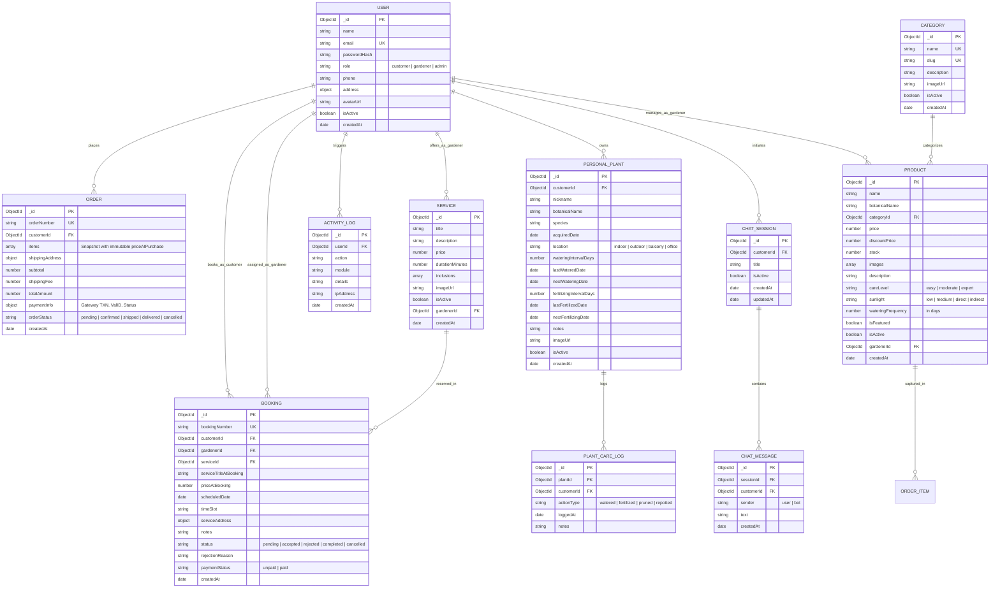

# FLORVA — DATABASE SCHEMA SPECIFICATION (REVISED & REFINED)

**Academic Practicum Project**  
**Student Name:** Rifat Bin Alam  
**Database:** MongoDB Atlas (Cloud NoSQL) with Mongoose ODM  
**Institution:** International University of Business Agriculture and Technology (IUBAT)  

---

## 1. Entity-Relationship (ER) Diagram



---

## 2. Collection Schemas & Mongoose Models (with Price Snapshotting)

### 2.1 `Order` Schema (Immutable Price Snapshotting)
```javascript
const orderItemSnapshotSchema = new mongoose.Schema({
  product: {
    type: mongoose.Schema.Types.ObjectId,
    ref: 'Product',
    required: [true, 'Product reference is required']
  },
  name: {
    type: String,
    required: [true, 'Product name snapshot is required']
  },
  botanicalName: {
    type: String,
    default: ''
  },
  priceAtPurchase: {
    type: Number,
    required: [true, 'Unit price at purchase must be preserved'],
    min: [0, 'Unit price must be positive']
  },
  quantity: {
    type: Number,
    required: [true, 'Quantity is required'],
    min: [1, 'Quantity must be at least 1']
  },
  totalItemPrice: {
    type: Number,
    required: [true, 'Total item price is required'],
    min: 0
  },
  image: {
    type: String,
    required: [true, 'Product image snapshot is required']
  }
}, { _id: false });

const orderSchema = new mongoose.Schema({
  orderNumber: {
    type: String,
    unique: true,
    required: true,
    index: true
  },
  customer: {
    type: mongoose.Schema.Types.ObjectId,
    ref: 'User',
    required: [true, 'Order must belong to a customer'],
    index: true
  },
  items: {
    type: [orderItemSnapshotSchema],
    validate: [val => val.length > 0, 'Order must contain at least one item']
  },
  shippingAddress: {
    fullName: { type: String, required: true },
    phone: { type: String, required: true },
    street: { type: String, required: true },
    city: { type: String, required: true },
    zipCode: { type: String, required: true }
  },
  subtotal: {
    type: Number,
    required: true,
    min: 0
  },
  shippingFee: {
    type: Number,
    default: 50,
    min: 0
  },
  totalAmount: {
    type: Number,
    required: true,
    min: 0
  },
  paymentInfo: {
    gateway: { type: String, default: 'sslcommerz_sandbox' },
    transactionId: { type: String, required: true, unique: true, index: true },
    valId: { type: String, default: '' },
    cardType: { type: String, default: '' },
    status: {
      type: String,
      enum: ['pending', 'paid', 'failed'],
      default: 'pending'
    },
    paidAt: { type: Date }
  },
  orderStatus: {
    type: String,
    enum: ['pending', 'confirmed', 'shipped', 'delivered', 'cancelled'],
    default: 'pending',
    index: true
  }
}, { timestamps: true });
```

---

### 2.2 `Booking` Schema (Historical Service Snapshotting)
```javascript
const bookingSchema = new mongoose.Schema({
  bookingNumber: {
    type: String,
    unique: true,
    required: true,
    index: true
  },
  customer: {
    type: mongoose.Schema.Types.ObjectId,
    ref: 'User',
    required: [true, 'Booking must belong to a customer'],
    index: true
  },
  gardener: {
    type: mongoose.Schema.Types.ObjectId,
    ref: 'User',
    required: [true, 'Booking must be assigned to the gardener'],
    index: true
  },
  service: {
    type: mongoose.Schema.Types.ObjectId,
    ref: 'Service',
    required: [true, 'Service reference is required']
  },
  serviceTitleAtBooking: {
    type: String,
    required: [true, 'Service title snapshot is required']
  },
  priceAtBooking: {
    type: Number,
    required: [true, 'Service price at booking must be preserved'],
    min: 0
  },
  scheduledDate: {
    type: Date,
    required: [true, 'Appointment date is required'],
    index: true
  },
  timeSlot: {
    type: String,
    required: [true, 'Time slot is required'],
    enum: ['09:00 AM - 11:00 AM', '11:00 AM - 01:00 PM', '02:00 PM - 04:00 PM', '04:00 PM - 06:00 PM']
  },
  serviceAddress: {
    street: { type: String, required: true },
    city: { type: String, required: true },
    phone: { type: String, required: true }
  },
  notes: {
    type: String,
    default: ''
  },
  status: {
    type: String,
    enum: ['pending', 'accepted', 'rejected', 'completed', 'cancelled'],
    default: 'pending',
    index: true
  },
  rejectionReason: {
    type: String,
    default: '',
    validate: {
      validator: function(val) {
        return this.status !== 'rejected' || (val && val.trim().length > 0);
      },
      message: 'Rejection reason is mandatory when declining a booking'
    }
  },
  paymentStatus: {
    type: String,
    enum: ['unpaid', 'paid'],
    default: 'unpaid'
  }
}, { timestamps: true });
```

---

### 2.3 `Product` Schema (Gardener Ownership & Care Details)
```javascript
const productSchema = new mongoose.Schema({
  name: {
    type: String,
    required: [true, 'Product name is required'],
    trim: true,
    maxlength: 120
  },
  botanicalName: {
    type: String,
    trim: true,
    default: ''
  },
  category: {
    type: mongoose.Schema.Types.ObjectId,
    ref: 'Category',
    required: [true, 'Product must belong to a category'],
    index: true
  },
  price: {
    type: Number,
    required: [true, 'Price is required'],
    min: [0, 'Price cannot be negative']
  },
  discountPrice: {
    type: Number,
    default: 0,
    min: 0
  },
  stock: {
    type: Number,
    required: [true, 'Stock count is required'],
    default: 0,
    min: [0, 'Stock cannot be negative']
  },
  images: [{
    type: String,
    required: true
  }],
  description: {
    type: String,
    required: [true, 'Description is required']
  },
  careLevel: {
    type: String,
    enum: ['easy', 'moderate', 'expert'],
    default: 'easy'
  },
  sunlight: {
    type: String,
    enum: ['low', 'medium', 'direct', 'indirect'],
    default: 'indirect'
  },
  wateringFrequency: {
    type: Number, // In days (e.g., 7)
    default: 7
  },
  isFeatured: {
    type: Boolean,
    default: false
  },
  isActive: {
    type: Boolean,
    default: true
  },
  gardener: {
    type: mongoose.Schema.Types.ObjectId,
    ref: 'User',
    required: [true, 'Product must have an assigned gardener owner'],
    index: true
  }
}, { timestamps: true });

productSchema.index({ name: 'text', botanicalName: 'text', description: 'text' });
productSchema.index({ category: 1, isActive: 1 });
```

---

### 2.4 `PersonalPlant` & `PlantCareLog` Schemas
```javascript
const personalPlantSchema = new mongoose.Schema({
  customer: {
    type: mongoose.Schema.Types.ObjectId,
    ref: 'User',
    required: true,
    index: true
  },
  nickname: {
    type: String,
    required: [true, 'Plant nickname is required'],
    trim: true
  },
  botanicalName: { type: String, default: '', trim: true },
  species: { type: String, default: '' },
  acquiredDate: { type: Date, default: Date.now },
  location: {
    type: String,
    enum: ['indoor', 'outdoor', 'balcony', 'office'],
    default: 'indoor'
  },
  wateringIntervalDays: { type: Number, required: true, min: 1, default: 5 },
  lastWateredDate: { type: Date, default: Date.now },
  nextWateringDate: { type: Date, required: true, index: true },
  fertilizingIntervalDays: { type: Number, default: 30 },
  lastFertilizedDate: { type: Date, default: Date.now },
  nextFertilizingDate: { type: Date, required: true },
  notes: { type: String, default: '' },
  imageUrl: { type: String, default: 'https://images.unsplash.com/photo-1485955900006-10f4d324d411?auto=format&fit=crop&w=400&q=80' },
  isActive: { type: Boolean, default: true }
}, { timestamps: true });

const plantCareLogSchema = new mongoose.Schema({
  plant: {
    type: mongoose.Schema.Types.ObjectId,
    ref: 'PersonalPlant',
    required: true,
    index: true
  },
  customer: {
    type: mongoose.Schema.Types.ObjectId,
    ref: 'User',
    required: true,
    index: true
  },
  actionType: {
    type: String,
    enum: ['watered', 'fertilized', 'pruned', 'repotted'],
    required: true
  },
  loggedAt: { type: Date, default: Date.now, index: true },
  notes: { type: String, default: '' }
}, { timestamps: true });
```
